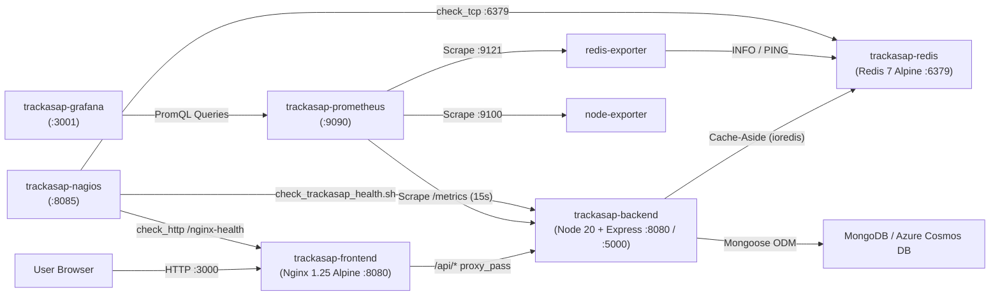

# TrackAsap DevOps & Observability — How Everything Works

A complete, end-to-end guide to how containerization, provisioning, configuration management, metrics, dashboards, and alerting fit together on the `devops` branch of **TrackAsap**.

---

## 1. Architecture & Traffic / Telemetry Flow



All core application containers and observability containers communicate over the shared Docker bridge network **`trackasap-net`** using container service DNS names (`backend`, `trackasap-backend`, `trackasap-frontend`, `trackasap-redis`, `prometheus`).

---

## 2. Containerization (Docker & Docker Compose)

### Application Containers ([`docker-compose.yml`](docker-compose.yml))
| Service | Source / Image | Host → Container Port | Healthcheck |
| :--- | :--- | :--- | :--- |
| **`redis`** | `redis:7-alpine` (`--appendonly yes`) | `6379:6379` | `redis-cli ping` every `10s` |
| **`backend`** | [`backend/Dockerfile`](backend/Dockerfile) (`node:20-alpine`) | `5000:8080` | `fetch('http://127.0.0.1:8080/api/health')` every `15s` |
| **`frontend`** | [`frontend/Dockerfile`](frontend/Dockerfile) (`node:20-alpine` → `nginx:1.25-alpine`) | `3000:8080` | `wget -qO- http://127.0.0.1:8080/nginx-health` every `30s` |
| **`learn`** *(profile: `learn` / `full`)* | [`learn/Dockerfile`](learn/Dockerfile) (`node:20-alpine` → `nginx:1.25-alpine`) | `5174:8080` | `wget -qO- http://127.0.0.1:8080/nginx-health` every `30s` |

### How Startup Ordering & Nginx Routing Work
1. `redis` boots first and waits until `redis-cli ping` passes.
2. `backend` waits on `redis` (`condition: service_healthy`), loads environment variables from `backend/.env` (`required: false` so fresh clones don't crash), and starts Express on internal port `8080` (mapped to `5000` on host).
3. `frontend` waits on `backend` (`condition: service_healthy`). Inside [`frontend/nginx.conf`](frontend/nginx.conf):
   - Requests to `/api/...` proxy directly to `http://backend:8080` **without a trailing slash** so the `/api/` prefix is preserved for Express routes (`/api/auth`, `/api/tasks`, `/api/health`, etc.), with WebSocket upgrade headers enabled.
   - Requests to `/nginx-health` return `200 ok` without polluting backend logs.
   - All other routes fall back to `/index.html` for React Router SPA navigation.
   - [`frontend/.dockerignore`](frontend/.dockerignore) intentionally allows `nginx.conf` into the Docker build context while excluding `node_modules` and `dist`.

### Separate Optional Stacks
- **LiveKit + Python AI Interviewer Worker**: [`docker/docker-compose.yml`](docker/docker-compose.yml) runs `livekit-server` (`7880`, `7881`, `7882/udp`) and [`ai-agent/Dockerfile`](ai-agent/Dockerfile).
- **Jenkins CI Controller**: [`jenkins/docker-compose.yml`](jenkins/docker-compose.yml) runs Jenkins LTS (`8086:8080`) with Docker CLI access (`jenkins/Dockerfile`).

---

## 3. Backend Observability Endpoints

Implemented in [`backend/src/analytics/middlewares/prometheusMetrics.js`](backend/src/analytics/middlewares/prometheusMetrics.js) and wired in [`backend/src/app.js`](backend/src/app.js):

### A. Prometheus Metrics (`GET /metrics` and `GET /api/metrics`)
Every incoming request passes through `prometheusMetricsMiddleware`:
- Tracks active requests (`trackasap_http_requests_in_flight`).
- Normalizes dynamic Mongo ObjectIds (`/^[0-9a-fA-F]{24}$/` → `/:id`) and numeric segments (`/:num`) to avoid label cardinality explosions.
- Records duration via `process.hrtime.bigint()` into histogram buckets (`0.025s` to `10s`, `+Inf`).
- Runs a 1-second event-loop lag sampler marked `.unref()` so test runners (like Jest) can exit cleanly without open-handle hangs.

**Exported Metrics:**
- `trackasap_http_requests_total{method, route, status_code}` (Counter)
- `trackasap_http_request_duration_seconds_bucket` / `_sum` / `_count` (Histogram)
- `trackasap_http_requests_in_flight` (Gauge)
- `trackasap_nodejs_event_loop_lag_seconds` (Gauge)
- `trackasap_nodejs_heap_used_bytes`, `trackasap_nodejs_heap_total_bytes`, `trackasap_nodejs_rss_bytes` (Gauges)
- `trackasap_process_uptime_seconds` (Gauge)
- `trackasap_db_connected` (`1` if `mongoose.connection.readyState === 1`, else `0`)
- `trackasap_redis_connected` (`1` if `redisClient.status === 'ready'`, else `0`)
- `trackasap_analytics_queue_size{queue="activity" | "request_log"}` (in-memory batch queue depth before 5-second Mongo flush)

### B. Deep Dependency Health (`GET /api/health/deep`)
Used by Nagios and rolling deployment checks:
- Inspects live Mongoose connection state and executes a `1000ms`-timeout `redisClient.ping()`.
- Returns **HTTP `200`** with `status: "ok"` (all up) or `status: "degraded"` (Redis unavailable — backend caches fail open), or **HTTP `503`** with `status: "critical"` if MongoDB is disconnected.

---

## 4. Monitoring Stack ([`docker-compose.monitoring.yml`](docker-compose.monitoring.yml))

Running `docker compose -f docker-compose.yml -f docker-compose.monitoring.yml up -d` adds five observability containers onto `trackasap-net`:

### A. Prometheus (`:9090`)
- **Config:** [`devops/prometheus/prometheus.yml`](devops/prometheus/prometheus.yml) scrapes every `15s`:
  - `trackasap-backend:8080/metrics`
  - `redis-exporter:9121`
  - `node-exporter:9100`
  - `localhost:9090`
- **Alert Rules:** [`devops/prometheus/alerts.yml`](devops/prometheus/alerts.yml) defines 6 alerts:
  - `TrackAsapBackendDown` (`up == 0` for `1m`)
  - `TrackAsapMongoDBDisconnected` (`trackasap_db_connected == 0` for `30s`)
  - `TrackAsapRedisDisconnected` (`trackasap_redis_connected == 0` for `2m`)
  - `TrackAsapHigh5xxRate` (`5xx / total > 5%` over `5m`)
  - `TrackAsapHighP95Latency` (P95 `> 1.5s` over `3m`)
  - `TrackAsapHighEventLoopLag` (event loop delay `> 250ms` for `2m`)

### B. Grafana (`:3001`)
- **Credentials:** `admin` / `trackasap_admin` (configurable via `GRAFANA_ADMIN_USER` / `GRAFANA_ADMIN_PASSWORD`).
- **Auto-Provisioning:** Mounts [`devops/grafana/provisioning`](devops/grafana/provisioning/dashboards/trackasap-overview.json):
  - [`datasources/datasource.yml`](devops/grafana/provisioning/datasources/datasource.yml) connects Grafana directly to `http://prometheus:9090`.
  - [`dashboards/dashboards.yml`](devops/grafana/provisioning/dashboards/dashboards.yml) loads [`trackasap-overview.json`](devops/grafana/provisioning/dashboards/trackasap-overview.json) automatically (MongoDB & Redis status stats, in-flight requests, uptime, RPS by status code, P95/P50 latency, Heap vs RSS memory, and event-loop lag + queue backlog).

### C. Nagios Core (`:8085`)
- **Credentials:** `nagiosadmin` / `trackasap_nagios`.
- **Auto-Loaded Configs:** [`devops/nagios/objects/`](devops/nagios/objects/trackasap-services.cfg) mounts into `/opt/nagios/etc/conf.d/trackasap:ro`:
  - [`trackasap-hosts.cfg`](devops/nagios/objects/trackasap-hosts.cfg): Defines `trackasap-backend`, `trackasap-frontend`, and `trackasap-redis`.
  - [`trackasap-commands.cfg`](devops/nagios/objects/trackasap-commands.cfg): Registers `check_trackasap_health`, `check_http_endpoint`, and `check_tcp_port`.
  - [`trackasap-services.cfg`](devops/nagios/objects/trackasap-services.cfg): Monitors backend `/api/health`, deep dependency health, `/metrics`, frontend `/nginx-health`, and Redis TCP `6379`.
- **Custom Plugin:** [`devops/nagios/plugins/check_trackasap_health.sh`](devops/nagios/plugins/check_trackasap_health.sh) queries `/api/health/deep` and parses JSON status + perfdata (`heap_mb`, `lag_ms`, `queue_pending`), returning standard Nagios exit codes (`0=OK`, `1=WARNING` if Redis fail-open or queue backlog `>= 200`, `2=CRITICAL` if unreachable or Mongo down, `3=UNKNOWN`).

---

## 5. Configuration Management & Provisioning

### A. Ansible ([`devops/ansible/`](devops/ansible/playbooks/site.yml))
Used for push-based server provisioning and zero-downtime rolling deploys over SSH:
- **Inventory & Vars:** [`inventory/hosts.ini`](devops/ansible/inventory/hosts.ini) splits servers into `app_servers`, `ai_workers`, and `monitoring_servers`; [`group_vars/all.yml`](devops/ansible/group_vars/all.yml) centralizes ports, branch (`devops`), and `/opt/trackasap`.
- **Master Playbook ([`playbooks/site.yml`](devops/ansible/playbooks/site.yml)):**
  1. `app_servers` → runs roles `docker_host` (Docker CE + `deb822_repository` + UFW ports `22, 80, 443, 5000, 3000, 7880, 7881, 7882/udp`), `trackasap_app` (git sync, optional [`backend.env.j2`](devops/ansible/roles/trackasap_app/templates/backend.env.j2) via Ansible Vault, `docker compose up -d --build`), and `monitoring_agent` (NRPE + Node Exporter + `check_trackasap_health.sh` + restart handler).
  2. `ai_workers` → installs Docker and starts `docker/docker-compose.yml` (LiveKit + Python AI Agent).
  3. `monitoring_servers` → installs Docker and starts `docker-compose.monitoring.yml`.
- **Rolling Deploy Playbook ([`playbooks/deploy.yml`](devops/ansible/playbooks/deploy.yml)):** Pulls `devops`, rebuilds `backend`/`frontend` one host at a time (`serial: 1`), waits for `http://127.0.0.1:5000/api/health/deep` to return `200`, and prunes dangling images.

### B. Puppet ([`devops/puppet/`](devops/puppet/manifests/site.pp))
Used for declarative state & configuration-drift enforcement:
- **Hiera ([`hiera.yaml`](devops/puppet/hiera.yaml), [`data/common.yaml`](devops/puppet/data/common.yaml)):** Stores ports, log rotation limits, and allowed NRPE monitor IPs.
- **Node Classification ([`manifests/site.pp`](devops/puppet/manifests/site.pp)):** Matches `^trackasap-app-.*$`, `^trackasap-ai-.*$`, and `default`.
- **Module Classes (`devops/puppet/modules/trackasap/manifests/`):**
  - [`init.pp`](devops/puppet/modules/trackasap/manifests/init.pp): Ensures base packages, `trackasap` user/group, and `/opt/trackasap/{logs,backups}`.
  - [`docker.pp`](devops/puppet/modules/trackasap/manifests/docker.pp): Manages `docker.io`, `/etc/docker/daemon.json` via [`daemon.json.erb`](devops/puppet/modules/trackasap/templates/daemon.json.erb) (`50m` x `3` log rotation + `live-restore: true`), and Docker service state.
  - [`nginx.pp`](devops/puppet/modules/trackasap/manifests/nginx.pp): Enforces host Nginx `/api/` proxy, restricts `/metrics` to localhost + monitoring subnet `10.0.2.0/24`, and notifies Nginx on change.
  - [`nagios_nrpe.pp`](devops/puppet/modules/trackasap/manifests/nagios_nrpe.pp): Deploys `check_trackasap_health.sh` and renders `/etc/nagios/nrpe.d/trackasap.cfg` via [`nrpe_trackasap.cfg.erb`](devops/puppet/modules/trackasap/templates/nrpe_trackasap.cfg.erb).

---

## 6. Daily Commands & CI Verification

### Start / Stop Everything Locally
```bash
# Start TrackAsap + Prometheus + Grafana + Nagios
docker compose -f docker-compose.yml -f docker-compose.monitoring.yml up -d

# Also include the Learn Architecture Lab (:5174)
docker compose -f docker-compose.yml -f docker-compose.monitoring.yml --profile learn up -d

# Stop containers (preserves volumes)
docker compose -f docker-compose.yml -f docker-compose.monitoring.yml down
```

### Run Verification Checks
```bash
# 1. Validate all YAML, JSON, Nagios CFGs, Puppet manifests, and Docker Compose files
python devops/scripts/verify_devops.py

# 2. Run backend observability unit tests
npm --prefix backend test -- tests/observability.test.js

# 3. Validate Prometheus & Nagios inside live containers
docker exec trackasap-prometheus promtool check config /etc/prometheus/prometheus.yml
docker exec trackasap-nagios /opt/nagios/bin/nagios -v /opt/nagios/etc/nagios.cfg
docker exec trackasap-nagios /opt/nagios/libexec/custom/check_trackasap_health.sh -H trackasap-backend -p 8080

# 4. Syntax-check Ansible & Puppet using Linux containers (helpful on Windows)
docker run --rm -e ANSIBLE_CONFIG=/ansible/ansible.cfg -v "$PWD/devops/ansible:/ansible:ro" -w /ansible alpine:latest sh -c "apk add --no-cache ansible-core && ansible-playbook playbooks/site.yml --syntax-check && ansible-playbook playbooks/deploy.yml --syntax-check"
docker run --rm -v "$PWD/devops/puppet:/puppet:ro" -w /puppet ubuntu:latest sh -c "apt-get update -qq && apt-get install -y -qq puppet && puppet parser validate manifests/site.pp modules/trackasap/manifests/*.pp"
```

### CI Pipeline ([`.github/workflows/test.yml`](.github/workflows/test.yml))
Pushes to `main`, `devops`, or `feature/**` run:
1. **`backend-tests`**: Express + Supertest Jest suite (`NODE_ENV=test`).
2. **`frontend-tests`**: Vitest suite + Vite production build check.
3. **`devops-verify`**: Python `verify_devops.py` across Docker Compose, Ansible, Puppet, Nagios, Prometheus, and Grafana configs.

### Windows Storage Tip (`S:` Drive)
To keep Docker Desktop's VHDX off `C:`, open **Docker Desktop → Settings → Resources → Advanced → Disk image location**, point it to `S:\DockerData`, and click **Apply & restart**.
